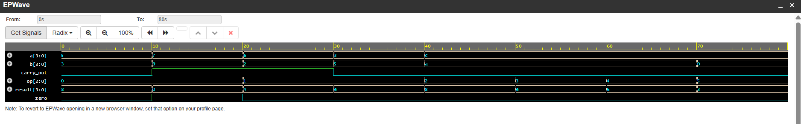

# 4-Bit ALU in Verilog

A 4-bit arithmetic logic unit (ALU) written in Verilog and verified in simulation
with Icarus Verilog on EDA Playground.

## Design

The ALU is built in three layers:

1. **Full adder** – adds three 1-bit inputs (a, b, carry-in) using logic gates
2. **4-bit ripple-carry adder** – four full adders chained together, each passing
   its carry to the next bit
3. **ALU** – selects one of six operations using a 3-bit opcode

## Operations

| op  | Operation | Result |
|-----|-----------|--------|
| 000 | ADD       | A + B  |
| 001 | SUB       | A − B  |
| 010 | AND       | A & B  |
| 011 | OR        | A \| B |
| 100 | XOR       | A ^ B  |
| 101 | NOT       | ~A     |

Outputs: `result[3:0]`, `carry_out`, and a `zero` flag that goes high when the
result is 0000.

## How subtraction works

Instead of building separate subtraction hardware, the ALU reuses the adder with
two's complement: **A − B = A + (~B) + 1**. A second adder receives the inverted
B input and a carry-in of 1.

## Verification

A self-checking testbench runs a test for every operation, including overflow
(7 + 9 = 0 with carry out) and a negative result (3 − 5 = 1110, which is −2 in
two's complement). All tests pass.

## Files

- `design.sv` – full adder, 4-bit adder, and ALU modules
- `testbench.sv` – self-checking testbench

## Running it

Paste both files into [EDA Playground](https://edaplayground.com/x/i74v), select
Icarus Verilog as the simulator, and click Run.
